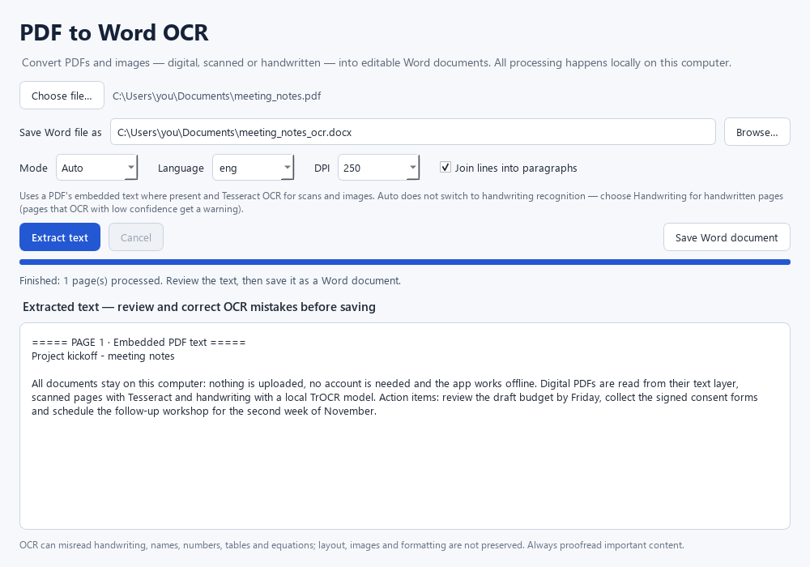

# PDF to Word OCR

**Private, on-device conversion of PDFs and images into editable Word documents.**
Text extraction, OCR and handwriting recognition all run on your own Windows PC, and
nothing is uploaded.



## Why on-device

Online converters upload your files to someone else's server. This app is for documents
you would rather keep to yourself, such as contracts, medical letters, IDs and notes:

- no account, no upload, no tracking;
- works offline;
- makes one network request at most: a one-time download of the handwriting model from
  Hugging Face, and only if the model isn't already on the PC. The portable build
  includes it, so that build never goes online.

## Features

| Mode | Use it for | How it works |
|---|---|---|
| **Auto** | Digital PDFs, scanned printed pages | Uses the PDF's own text; pages without text are OCR'd with [Tesseract](https://github.com/tesseract-ocr/tesseract) |
| **Printed Text** | Scanned typed or printed documents | Tesseract on every page |
| **Handwriting** | Handwritten pages (English) | [TrOCR](https://huggingface.co/microsoft/trocr-base-handwritten), line by line |

- Opens PDFs and images (PNG, JPG, TIFF, BMP, GIF, WEBP).
- Cleans up phone photos and scans before OCR: crops to the paper, evens out shadows,
  picks the colour channel with the most contrast and straightens tilted pages. Pages that
  read poorly are tried several ways and the most confident reading wins.
- Handwriting mode leaves out lines the model can't read reliably, and says how many,
  instead of inventing text.
- Shows the recognized text for review and editing before saving it as `.docx`.
- Turns printed line breaks back into paragraphs and rejoins words split by a hyphen, so
  the Word text reflows when edited. Untick *Join lines into paragraphs* to keep the
  original line breaks.
- Runs in the background with progress and cancel. Uses an NVIDIA GPU when available,
  otherwise the CPU.
- Auto mode does **not** detect handwriting. When Tesseract's confidence on a page is
  low, the app suggests switching to Handwriting mode.

## Results

Measured on a private test set of hard real-world documents: receipt photos (CORD, SROIE,
Wikimedia Commons and a CamScanner taxi receipt), handwritten letters, notes and forms
(GNHK, and one scanned letter), and research papers including a two-column IEEE paper.
"Words found" is the F1 score of the recognized words against a hand-checked
transcription (1.0 = every word right, nothing extra).

| Documents | Mode | Words found, original → now | Characters wrong, original → now |
|---|---|---|---|
| 7 receipt photos and scans | Auto | 0.56 → **0.67** | 42% → **26%** |
| 7 handwritten pages | Handwriting | 0.39 → **0.81** | 62% → **17%** |
| 4 unseen receipts* | Auto | 0.42 → **0.58** | 53% → 45% |
| 5 unseen handwritten pages* | Handwriting | 0.21 → **0.50** | 81% → **57%** |
| 6 research papers, digital and scanned | Auto | 0.98 → 0.98 | 2.6% of words wrong; column order kept |

\* Never used while tuning, to check that the gains carry over to new documents.

Examples: the taxi receipt went from 7 to 18 of 22 key fields (amounts, dates, IDs); a
neat 26-line handwritten letter has 1% of characters wrong, in about 35 s on an 8-core CPU; a
scanned two-column IEEE paper read in the right column order has 4% of words wrong.
The test set is not published because of its licences and private documents.

## Download and run

The portable Windows build needs no installation and works offline: Tesseract and the
handwriting model are inside.

1. Get `PDFtoWordOCR-portable.zip` (about 1.1 GB; 2.2 GB unpacked), either from
   [Releases](https://github.com/mridul0837/pdf-to-word-ocr/releases) when published,
   or by [building it](#build-the-portable-app).
2. Right-click the ZIP and choose **Extract All**, then double-click
   `PDFtoWordOCR.exe`. Keep it inside the extracted folder.
3. If Windows says "Windows protected your PC", choose **More info → Run anyway**. The
   app is not code-signed.

## Run from source

Requires Windows 10/11 and Python 3.11–3.13.

```powershell
git clone https://github.com/mridul0837/pdf-to-word-ocr.git
cd pdf-to-word-ocr
py -3.13 -m venv .venv
.\.venv\Scripts\python.exe -m pip install -r requirements-dev.txt
winget install --id UB-Mannheim.TesseractOCR      # printed-text OCR engine
.\.venv\Scripts\python.exe desktop_app.py
```

- **Tesseract** is found automatically, in this order: a `tesseract\` folder next to the
  app, the `TESSERACT_CMD` environment variable, `PATH`, then the standard install folder.
- **Handwriting model** (~1.3 GB) downloads on first use and is then cached. To fetch it
  ahead of time, run `.\.venv\Scripts\python.exe -m ocr_app.fetch_model`.
- **GPU:** for NVIDIA acceleration, install a CUDA build of PyTorch before the requirements.

## Tests

```powershell
.\.venv\Scripts\python.exe -m pytest
```

The suite runs offline in about 25 seconds. External engines and the GUI's dialogs are
mocked. Tests marked `integration` use the real Tesseract, and the real TrOCR model when
`PDFOCR_RUN_MODEL_TESTS=1` is set. They skip themselves when those are unavailable.

## Build the portable app

```powershell
.\build_exe.ps1       # tests, PyInstaller one-folder build, self-test  -> dist\PDFtoWordOCR\
.\make_portable.ps1   # bundles Tesseract + model, re-tests with local installs hidden -> dist\PDFtoWordOCR-portable.zip
```

`make_portable.ps1` needs Tesseract installed on the build PC. It also puts the
plain-language [user manual](docs/USER_MANUAL.md) in the ZIP and beside it. On any PC,
`PDFtoWordOCR.exe --self-test report.json` reports which features work there.

## Project layout

```
desktop_app.py          PySide6 window and entry point
ocr_app/pipeline.py     File loading, Tesseract, line segmentation, TrOCR, orchestration
ocr_app/imaging.py      Photo clean-up: paper crop, lighting, ink mask, rules/frames, deskew
ocr_app/reflow.py       Rebuilds paragraphs and repairs hyphenated words
ocr_app/docx_export.py  Edited text -> .docx (page markers -> page breaks)
ocr_app/fetch_model.py  Downloads or exports the handwriting model
ocr_app/selftest.py     Headless checks for a built app
tests/                  pytest suite
docs/USER_MANUAL.*      Plain-language manual for end users (.md and .txt)
build_exe.ps1, make_portable.ps1, PDFtoWordOCR.spec   Packaging
```

## Limitations

- Output is clean paragraphs with page breaks. Columns, tables, images and fonts are not
  reproduced, and text inside figures becomes separate short paragraphs.
- Handwriting recognition is English-only and works best on clearly separated horizontal
  lines. Always proofread names, numbers and dates.
- Crumpled or folded receipt photos still read poorly. Dot-matrix printing with slashed
  zeros is often misread (0 as 6 or 8), and similar characters in IDs (0/O, 1/l) get confused.
- The handwriting model is trained on handwriting: on printed text, forms or pictures it can
  produce confident-looking text that isn't there. Use it only for handwritten pages.
- Windows only; tested on Windows 10 with Python 3.13.

## Third-party components

The app is built on PyMuPDF (AGPL-3.0), PySide6 (LGPL-3.0), Tesseract (Apache-2.0),
PyTorch (BSD-3-Clause), Hugging Face Transformers (Apache-2.0), OpenCV (Apache-2.0),
python-docx (MIT) and Microsoft's TrOCR model (see its model card). Check these licences
before redistributing builds: PyMuPDF's AGPL terms apply to distributed copies.
